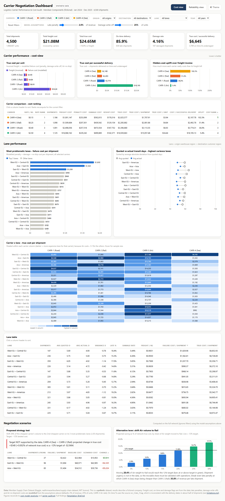
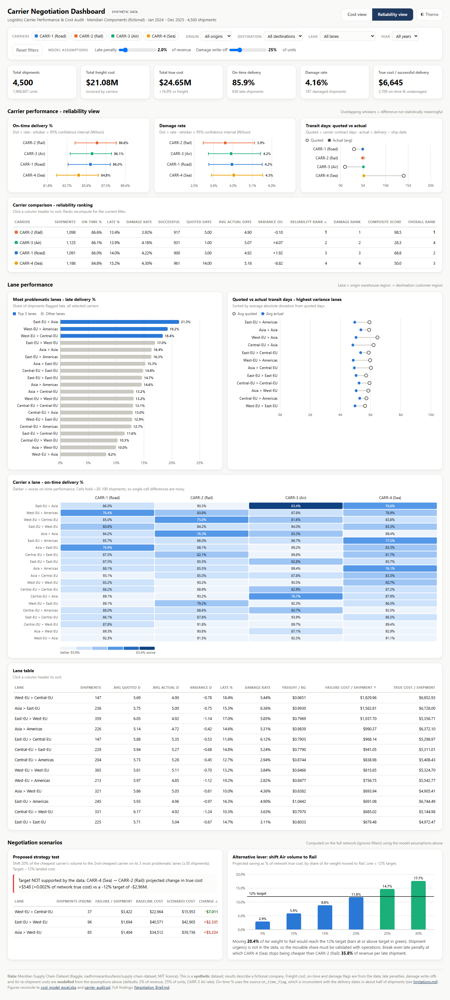

# Logistics Carrier Performance & Cost Audit

**Is the cheapest shipping carrier really the cheapest?** This is an end-to-end supply-chain analytics project. It works out the *true* cost of four freight carriers (freight plus late penalties, damage write-offs and expedited reshipments), tests how reliable they are, finds the problem lanes, and evaluates a proposed carrier-reallocation strategy against a 12% cost-reduction target.

`Data Analytics` · `Supply Chain Analytics` · `Logistics` · `PostgreSQL` · `Excel` · `Business Intelligence` · `Python`



> **Data transparency.** The project uses the [Meridian Supply Chain Dataset](https://www.kaggle.com/datasets/nadhirmazariboufares/supply-chain-dataset) from Kaggle (MIT licence). Its publisher describes it as **synthetic** teaching data about a fictional manufacturer, *Meridian Components*. All results come from that real downloaded file. No rows were invented or altered. Penalty, damage and reshipment costs are **modelled** from documented assumptions, because the dataset has no such fields.

---

## Contents
[Executive summary](#executive-summary) · [Business problem](#business-problem) · [Objectives](#objectives) · [Dataset](#dataset) · [Tools](#tools-and-technologies) · [Architecture](#project-architecture) · [Folder structure](#folder-structure) · [Data cleaning](#data-cleaning-methodology) · [Excel](#excel-analysis) · [SQL](#sql-analysis) · [Python](#python-workflow) · [Dashboard](#dashboard-features) · [Metrics](#key-business-metrics) · [Findings](#major-findings) · [Recommendations](#recommendations) · [Financial impact](#financial-impact) · [Run it](#installation-and-execution) · [Validation](#validation-and-testing) · [Limitations](#known-limitations) · [Future work](#future-improvements) · [Navigation](#how-to-navigate-the-repository)

---

## Executive Summary

| Question | Answer from the data |
|---|---|
| Is the cheapest carrier secretly the most expensive? | **No.** CARR-4 (Sea) has the lowest true cost: **$3.94/unit** vs $4.84 for Rail. Penalties would need to exceed 35.8% of revenue to change that. |
| Are its hidden costs material? | **Yes.** Its modelled failure costs ($1.02M) exceed its freight bill ($1.00M), a 102% uplift that gives leverage for SLA and damage clauses. |
| Are some carriers more reliable? | **Not measurably.** On-time ranges from 84.8% to 86.6%; all pairwise differences have p > 0.2. |
| Does a 20% shift from Sea to Rail on the 3 worst lanes cut cost by 12%? | **No.** It changes true cost by **+$548 (+0.002%)**. |
| Where is the 12%? | **Air.** It takes 76% of freight spend for 25% of the weight. Moving about **20% of Air weight to Rail ≈ $2.9M (≈12%)**. |

## Business Problem

A Logistics Manager wants to renegotiate carrier contracts. The company suspects that its cheapest carrier by contract rate is actually the most expensive once late deliveries, damage, penalties and expedited reshipments are counted. Management has proposed **shifting 20% of volume from the cheapest carrier to the second-cheapest carrier on the three most problematic lanes**, aiming for a **12% reduction in total landed cost**.

## Objectives

1. Calculate the **true cost** of each carrier per shipment, per unit and per successful (on-time, undamaged) delivery.
2. Evaluate carrier **reliability** (on-time %, late %, damage rate, transit time) and test whether the differences are statistically meaningful.
3. Identify **problematic origin-to-destination lanes**.
4. **Rank** carriers on cost, reliability, damage and overall value.
5. **Test the proposed strategy** with the data, treating the 12% target as a hypothesis, and recommend an allocation.

## Dataset

| | |
|---|---|
| Source | Kaggle: `nadhirmazariboufares/supply-chain-dataset`, downloaded via the Kaggle API |
| Type | **Synthetic** (publisher-generated, Python/NumPy), MIT licence |
| Size | 11 tables, 85 columns, **44,917 rows**, 2024–2025 |
| Tables | `carrier`, `warehouse`, `customer`, `product`, `supplier`, `shipment`, `shipment_line`, `purchase_order`, `purchase_order_line`, `inventory_snapshot`, `production_run` |
| Used in the audit | `shipment` (4,500) → `shipment_line` (9,059), joined to `carrier`, `warehouse` (lane origin), `customer` (lane destination) and `product` (weight, standard cost) |

Entity-relationship and column definitions: **[data/data_dictionary.md](data/data_dictionary.md)**. Licence and attribution: [data/raw/DATA_LICENSE.md](data/raw/DATA_LICENSE.md).

**Dataset limitations, in brief:** synthetic data; no penalty, claim or reshipment fields, so those costs are modelled; `on_time_flag` conflicts with the delivery dates for 49% of shipments; no shipment-urgency field. See [Known limitations](#known-limitations).

## Tools and Technologies

| Tool | Used for |
|---|---|
| **PostgreSQL 16** | Schema with primary and foreign keys, data load, validation, cleaning views, scorecards, ranking with window functions, scenario modelling ([sql/carrier_audit.sql](sql/carrier_audit.sql)) |
| **Microsoft Excel** | 9-sheet cost model with about 37,000 live formulas (SUMIFS, COUNTIFS, AVERAGEIFS, IFERROR, INDEX/MATCH, RANK, SUMPRODUCT), an editable assumptions panel, charts and conditional formatting |
| **HTML / JavaScript / SVG** | Self-contained interactive dashboard: no libraries, no server, works offline |
| **Python (pandas)** | Data profiling, reconciliation, and building the workbook and dashboard ([scripts/](scripts/)) |

## Project Architecture

```
 Kaggle CSVs (11 tables)                          data/raw/
        │
        ▼
 Profiling & data-quality checks ──► data/processed/data_quality_report.csv
        │
        ▼
 Shipment fact table (lines rolled up to shipment grain, then joined)
 + modelled cost components  ──────► data/processed/shipment_fact.csv
        │
        ├──► PostgreSQL  sql/carrier_audit.sql      (views: v_shipment_true_cost, scorecards, scenarios)
        ├──► Excel       excel/cost_model_excel.xlsx (formulas over Cleaned_Data + Cost_Model inputs)
        ├──► Dashboard   dashboard/carrier_negotiation_dashboard.html (data embedded, recomputed in-browser)
        └──► Reports     Negotiation_Brief.md, analysis/, reports/
```

All three engines (SQL, Excel and Python/JavaScript) compute the same true cost on their own, and their results were reconciled shipment by shipment.

## Folder Structure

```
Logistics-Carrier-Performance-Cost-Audit/
├── README.md                          ← you are here
├── Negotiation_Brief.md               ← consulting-style deliverable for the Logistics Manager
├── requirements_and_assumptions.md    ← scope, business rules, cost-model assumptions
├── methodology.md                     ← step-by-step analytical method and formulas
├── business_recommendations.md        ← actionable recommendations and negotiation levers
├── limitations.md                     ← data caveats and analytical limitations
├── .gitignore
├── .gitattributes                     ← line-ending / binary rules
├── data/
│   ├── raw/                           ← 11 original Kaggle CSVs (unaltered) + DATA_LICENSE.md
│   ├── processed/                     ← fact table, scorecards, scenarios, DQ report, summary JSON
│   └── data_dictionary.md
├── sql/
│   └── carrier_audit.sql              ← PostgreSQL: DDL, load, validation, analysis, recommendations
├── excel/
│   └── cost_model_excel.xlsx          ← 9-sheet formula-driven cost model
├── dashboard/
│   ├── carrier_negotiation_dashboard.html  ← open in any browser
│   └── assets/                        ← dashboard screenshots
├── analysis/
│   ├── carrier_performance_analysis.md
│   ├── lane_analysis.md
│   └── cost_analysis.md
├── reports/
│   ├── executive_summary.md
│   └── project_preview.md
└── scripts/                           ← pipeline that produced the outputs (already run; optional)
    ├── README.md                      ← rebuild order
    ├── requirements.txt               ← pinned Python packages for the scripts
    ├── build_analysis.py
    ├── build_excel.py
    ├── cache_excel_values.py
    ├── build_dashboard.py
    └── dashboard_template.html
```

## Data Cleaning Methodology

The data passed every structural check. The full report is in [data/processed/data_quality_report.csv](data/processed/data_quality_report.csv).

| Check | Result | Action |
|---|---|---|
| Nulls, fully duplicated rows, duplicate primary keys (all 11 tables) | 0, except 193 null `actual_delivery_date` in `purchase_order` | Purchase orders are out of scope; kept and documented |
| Orphan foreign keys (shipment → carrier/warehouse/customer; line → shipment/product) | 0 | Enforced by PostgreSQL foreign keys on load |
| Invalid or unparseable dates; delivery before ship date | 0 | None needed |
| Flags outside {0,1}; non-positive quantities; negative revenue or freight | 0 | Defensive filters kept in SQL views |
| Same product on two lines of one shipment | 316 lines (157 pairs) | Legitimate split lines (different quantities, list-price-consistent); kept |
| **`on_time_flag` vs dates** | **2,224 / 4,500 disagree** | **Flag kept as SLA metric of record; date-based transit times reported with a caveat** |

**Grain control:** `shipment_line` is aggregated to one row per shipment *before* joining to shipment attributes, so shipment-level flags and penalties are never multiplied by line count. A reconciliation query confirms that line-level freight equals fact-level freight ($21,077,048.77).

## Excel Analysis

[excel/cost_model_excel.xlsx](excel/cost_model_excel.xlsx) opens on the Executive Summary.

| Sheet | Contents |
|---|---|
| `Raw_Data` | Original `shipment` (4,500 rows) and `shipment_line` (9,059 rows) |
| `Cleaned_Data` | 4,500-row shipment fact table; transit days, flags and every cost component are **formulas** |
| `Data_Dictionary` | Column definitions, sources and derivations |
| `Carrier_Cost_Analysis` | Freight, penalty, damage, reshipment and true cost; per shipment, per unit, per on-time and per successful delivery; ranks; 3 charts |
| `Carrier_Performance` | On-time, late, damage, success rate, quoted vs actual transit, composite score and ranks; 3 charts |
| `Lane_Analysis` | 20-lane scorecard plus the cheapest carrier's lane ranking that *selects* the strategy lanes; 2 charts |
| `Cost_Model` | **Editable assumptions** (blue on yellow), rate card, strategy test, Air→Rail lever, penalty sensitivity, break-even |
| `Pivot_Analysis` | Pivot-style cross-tabs: carrier × lane true cost and on-time %, carrier × year, origin × destination |
| `Executive_Summary` | KPI cards, carrier snapshot, strategy verdict and formula-driven key findings |

Change any assumption on `Cost_Model` (penalty rate, write-off share, shift share, target) and every sheet recalculates. The workbook was checked with an independent formula engine: **37,041 formulas, 0 errors**.

## SQL Analysis

[sql/carrier_audit.sql](sql/carrier_audit.sql) is a single PostgreSQL script. It ran end to end on PostgreSQL 16.2 with `ON_ERROR_STOP`.

* **A. Preparation:** schema, 11 typed tables with PK/FK/CHECK constraints, `\copy` load, row counts, data-quality checks, flag/date consistency test, a parameter table, cleaning views (`v_shipment_lines`, `v_shipment_fact`, `v_shipment_true_cost`) and a freight reconciliation.
* **B. Carrier scorecard:** shipments, on-time %, late %, damage %, average transit, freight, penalties, cost per on-time and per successful delivery.
* **C. True cost:** components, per shipment, per unit, hidden-cost uplift, share of network cost.
* **D. Lane analysis:** quoted vs actual days, variance, average delay, freight-rate CV, problem-lane ranking, carrier × lane matrix.
* **E. Ranking:** `RANK()` by true cost, reliability and damage, plus a min-max normalised composite score.
* **F. Recommendations:** contract-rate rank vs true-cost rank, strategy test with a verdict, Air→Rail lever, break-even penalty rate, spend concentration.

## Python Workflow

The pipeline that produced every output is in [scripts/](scripts/). It has already been run, and its outputs are committed.

| Script | Role |
|---|---|
| [build_analysis.py](scripts/build_analysis.py) | Loads the 11 CSVs, runs the data-quality checks, builds the shipment fact table (lines rolled up first), applies the cost model, computes the scorecards, scenario, mode shift, sensitivity and z-tests. Writes `data/processed/` |
| [build_excel.py](scripts/build_excel.py) | Generates the 9-sheet workbook with openpyxl: live formulas, charts, conditional formatting |
| [cache_excel_values.py](scripts/cache_excel_values.py) | Evaluates every workbook formula with an independent engine, **fails on any Excel error**, and stores the results so the file displays in any viewer |
| [build_dashboard.py](scripts/build_dashboard.py) | Embeds the fact table as compact JSON into [dashboard_template.html](scripts/dashboard_template.html), producing one offline HTML file |

Money values are rounded half-up in exact decimal arithmetic, matching PostgreSQL and Excel `ROUND()`. That is why the Python and SQL outputs agree to the cent.

## Dashboard Features

[dashboard/carrier_negotiation_dashboard.html](dashboard/carrier_negotiation_dashboard.html) is one 300 KB file. Double-click it to open it in any modern browser. It needs no internet, no install and no server.

* **Six KPI cards:** shipments, freight cost, true cost, on-time %, damage rate, true cost per successful delivery.
* **Cost view / Reliability view toggle:** each view has its own charts, carrier table and ranking.
* **Cost view:** true cost per unit (freight vs failure cost), cost per successful delivery, hidden-cost uplift.
* **Reliability view:** on-time % and damage rate with 95% confidence intervals, quoted vs actual transit days.
* **Lane analysis:** problem-lane ranking, highest-variance lanes (quoted vs actual), carrier × lane heatmap, sortable lane table.
* **Filters:** carriers, origin, destination, lane (cascading) and year. All charts and KPIs recompute from the 4,500 embedded shipments.
* **Live assumptions:** sliders for penalty rate and damage write-off share.
* **Scenario panel:** strategy verdict and Air→Rail savings curve against the 12% target.
* Tooltips on every mark, keyboard focus, colour-blind-validated palette, light/dark themes, responsive layout.



## Key Business Metrics

| Metric | Definition |
|---|---|
| **True cost** | Freight + late penalty + damage write-off + expedited reshipment |
| **True cost per unit** | True cost ÷ units shipped |
| **Cost per successful delivery** | True cost ÷ shipments that were on time **and** undamaged |
| **Hidden-cost uplift** | True cost ÷ freight − 1 |
| **Failure cost per shipment** | (Penalty + damage + reshipment) ÷ shipments, used to rank lanes |
| **On-time % / late % / damage rate** | Share of shipments flagged on time / late / damaged |
| **Transit variance** | Actual days (delivery − ship) − quoted carrier days |
| **Composite score** | 50% true cost per unit + 30% on-time % + 20% damage rate, min-max normalised |

## Major Findings

| | Network (4,500 shipments) |
|---|---|
| Freight cost | **$21.08M** |
| True cost | **$24.65M** (+16.9%) |
| On-time delivery | **85.9%** |
| Damage rate | **4.16%** |
| True cost per successful delivery | **$6,645** |

| Carrier | Contract $/kg | True cost / unit | On-time % | Damage | Hidden-cost uplift | Overall rank |
|---|---:|---:|---:|---:|---:|---:|
| CARR-4 (Sea) | $0.15 | **$3.94** | 84.8% | 4.30% | 102% | 3 |
| CARR-2 (Rail) | $0.25 | $4.84 | 86.6% | 3.92% | 51% | **1** |
| CARR-1 (Road) | $0.40 | $6.93 | 86.0% | 4.22% | 36% | 2 |
| CARR-3 (Air) | $2.50 | $34.44 | 86.1% | 4.18% | 5% | 4 |

1. **The hypothesis is not supported.** The cheapest carrier, CARR-4 (Sea), is also cheapest on true cost. Penalties would have to exceed **35.8% of revenue** per late shipment to change that.
2. **Its hidden costs are real.** Sea's modelled failure costs ($1.02M) exceed its freight bill ($1.00M), which gives leverage for SLA and damage clauses.
3. **Reliability is statistically indistinguishable** across carriers (all pairwise p > 0.2).
4. **The proposed 20% shift on 3 lanes changes true cost by +$548 (+0.002%)**, far from the −12% target.
5. **Air takes 76% of freight spend for 25% of weight** with no reliability advantage. Moving about **20% of Air weight to Rail** would save about **$2.9M (≈12%)**.
6. The worst lane, **West-EU → Central-EU**, has a failure cost per shipment of $1,830, 2.3× the network average.

## Recommendations

1. Reject the 20% Sea→Rail lane shift as the route to 12%; it is cost-neutral.
2. Keep Sea as the low-cost backbone, and negotiate **SLA credits and damage liability** rather than reducing its volume.
3. Make **Rail the preferred carrier** for overall value, and use its metrics as the benchmark in negotiations.
4. Launch an **urgency-based Air→Rail programme**: pilot at 5%, scale towards about 20%.
5. Fix the source data: reconcile on-time flags with dates, and capture actual penalties and claims.

Full detail: **[Negotiation_Brief.md](Negotiation_Brief.md)** · [business_recommendations.md](business_recommendations.md)

## Financial Impact

| Option | Projected effect on network true cost ($24.65M) | Status |
|---|---:|---|
| Proposed: 20% Sea→Rail on the 3 most problematic lanes | **+$548 (+0.002%)** | Target **not** supported |
| Lane-selective: 20% Sea→Rail on West-EU → Central-EU only | −$7,011 | Small, but positive |
| Sea contract: recover 50% of modelled damage and reshipment cost | ≈ −$385,700 (−1.6%) | Illustrative arithmetic |
| Air→Rail mode shift, 5% pilot | −$725,485 (−2.9%) | Requires urgency validation |
| **Air→Rail mode shift, 20% of Air weight** | **−$2,901,939 (−11.8%)** | 20.4% reaches **−12%** |

*Expected-value projections at current per-kg rates, under the documented cost-model assumptions.*

## Installation and Execution

**Using the deliverables needs no installation:**

| Deliverable | How to open |
|---|---|
| Dashboard | Download [dashboard/carrier_negotiation_dashboard.html](dashboard/carrier_negotiation_dashboard.html) and double-click it. Works offline in Chrome, Edge, Firefox or Safari |
| Excel model | Open [excel/cost_model_excel.xlsx](excel/cost_model_excel.xlsx) in Excel 2010 or later; edit the yellow cells on `Cost_Model` |
| Reports | Read the Markdown files directly on GitHub |

**Running the SQL** (PostgreSQL 13+), from the repository root:

```bash
createdb carrier_audit
psql -d carrier_audit -v ON_ERROR_STOP=1 -f sql/carrier_audit.sql
```

**Reproducing the outputs** (optional, Python 3.10+), from the repository root after cloning:

```bash
pip install -r scripts/requirements.txt
python scripts/build_analysis.py      # data/processed/
python scripts/build_excel.py         # excel/cost_model_excel.xlsx
python scripts/cache_excel_values.py  # verify formulas + cache results (~3 min)
python scripts/build_dashboard.py     # dashboard/carrier_negotiation_dashboard.html
```

Details: [scripts/README.md](scripts/README.md).

## Validation and Testing

| Test | Result |
|---|---|
| SQL script executed end to end on PostgreSQL 16.2 (`ON_ERROR_STOP=1`), with all FK/CHECK constraints enforced on load | ✅ Pass |
| SQL vs Python fact table, every money and flag column, all 4,500 shipments | ✅ Max difference $0.00 |
| Freight reconciliation: line level = shipment level | ✅ $21,077,048.77 = $21,077,048.77 |
| Excel: 37,041 formulas evaluated with an independent engine | ✅ 0 errors |
| Excel headline results vs SQL (strategy change, Air share, break-even, ranks, lanes) | ✅ Identical (network total within $0.10, engine half-cent rounding) |
| Dashboard in headless Chrome: KPIs, carrier and scenario tables vs SQL | ✅ Identical |
| Dashboard interactions (carrier/year/origin filters, lane cascade, penalty slider, sort, view toggle) vs pandas | ✅ Identical |
| Palette: colour-blind separation and contrast checked with a validator | ✅ Pass (low-contrast slots backed by labels and tables) |
| Clean-room rebuild from raw CSVs with `scripts/` | ✅ Processed files and dashboard byte-identical; all 261,515 workbook cells identical |
| Repository audit: broken links, empty files, credentials or personal paths | ✅ None found |

Method detail: [methodology.md](methodology.md) §10.

## Known Limitations

1. **Synthetic data:** findings illustrate the method; they are not claims about real carriers.
2. **Modelled costs:** penalties (2% of revenue), damage write-offs (25% of units) and Air reshipments are assumptions. The Sea-vs-Rail ranking holds up to a 35.8% penalty rate.
3. **Flag/date conflict:** `on_time_flag` disagrees with the dates for 49% of shipments, so transit-time metrics are descriptive only.
4. **Small carrier × lane samples** (29–112 shipments) make single-carrier lane rankings noisy.
5. **No urgency field:** the Air→Rail saving assumes that volume can travel more slowly.

Full list: [limitations.md](limitations.md).

## Future Improvements

* Replace modelled costs with **actual credit notes, claims and expedite invoices** from the ERP or TMS.
* Reconcile on-time flags with carrier tracking (EDI/API) events, and compute **OTIF** against customer-requested dates.
* Add **shipment urgency and service level** to size the movable Air volume properly.
* Add **lane-level contract rates** and capacity constraints, and solve the allocation as a **linear program** (minimise true cost subject to capacity and service-level constraints).
* Add **carbon cost** (`co2_kg_per_km` is in the data) as a third dimension of the scorecard.
* Schedule the SQL as a monthly **dbt** model feeding the dashboard, with automated data-quality tests.

## How to Navigate the Repository

| If you want to… | Open |
|---|---|
| Read the business answer in 5 minutes | [reports/executive_summary.md](reports/executive_summary.md) |
| Read the full consulting deliverable | [Negotiation_Brief.md](Negotiation_Brief.md) |
| Explore the data interactively | [dashboard/carrier_negotiation_dashboard.html](dashboard/carrier_negotiation_dashboard.html) (download and double-click) |
| Inspect formulas and change assumptions | [excel/cost_model_excel.xlsx](excel/cost_model_excel.xlsx) → `Cost_Model` sheet |
| Review the SQL | [sql/carrier_audit.sql](sql/carrier_audit.sql) |
| Understand the method and caveats | [methodology.md](methodology.md) · [requirements_and_assumptions.md](requirements_and_assumptions.md) · [limitations.md](limitations.md) |
| See the detailed analyses | [analysis/](analysis/) |
| See a visual walkthrough | [reports/project_preview.md](reports/project_preview.md) |
| Reproduce the outputs (optional) | [scripts/README.md](scripts/README.md) |

## License and Attribution

* **Dataset:** Meridian Supply Chain Dataset by Kaggle user *nadhirmazariboufares*, released under the MIT licence. Redistributed unaltered in `data/raw/` with attribution ([DATA_LICENSE.md](data/raw/DATA_LICENSE.md)).
* **Project code and documentation:** no licence file is included yet, so default copyright applies. Add a `LICENSE` file if you want to allow reuse.

---

*Dataset: Meridian Supply Chain Dataset by nadhirmazariboufares (Kaggle), MIT licence, synthetic. Findings describe a fictional company and illustrate the analytical method; they are not claims about real carriers.*
