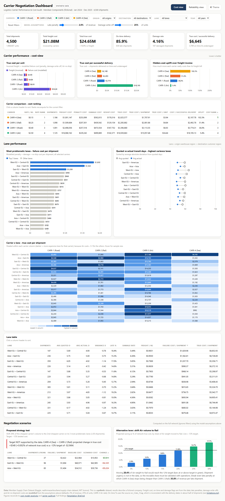
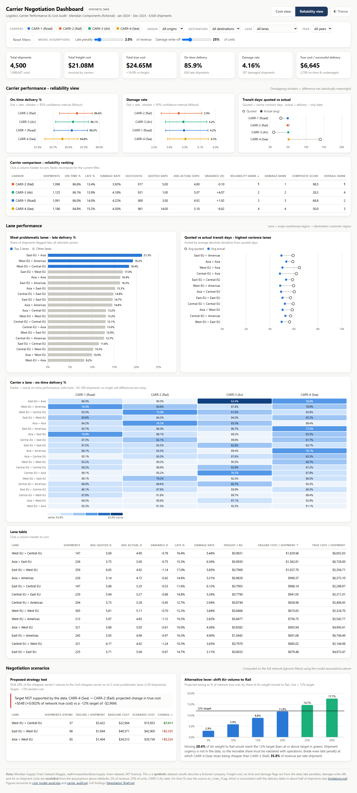

# Project Preview

A visual walkthrough of the deliverables. All screenshots are of the actual files in this repository.

## 1. Interactive dashboard - Cost view
`dashboard/carrier_negotiation_dashboard.html` is one self-contained file. Open it in any browser; no internet or installation is needed.



What to look at:
* **KPI cards:** freight $21.08M vs true cost $24.65M (+16.9%).
* **True cost per unit:** Sea is cheapest even after failure costs (red segment).
* **Hidden-cost uplift:** Sea's true cost is 102% above its freight invoice.
* **Negotiation scenarios:** the proposed strategy verdict (+$548, target not supported) and the Air→Rail savings curve crossing the 12% line at about 20%.

## 2. Interactive dashboard - Reliability view
Switch with the **Cost view / Reliability view** toggle (or open the file with `?view=rel`).



What to look at:
* **On-time % and damage rate with 95% confidence intervals:** the whiskers overlap, so the carriers are statistically equal.
* **Quoted vs actual transit:** every carrier averages about 5 days regardless of mode (data caveat).
* **Carrier × lane heatmap:** where each carrier underperforms.

### Interactions
| Control | Effect |
|---|---|
| Carrier chips | Include or exclude carriers; all charts, KPIs and ranks recompute |
| Origin / Destination / Lane / Year | Cascading filters over the 4,500 embedded shipments |
| Late penalty / Damage write-off sliders | Re-price the modelled costs live, including the scenarios |
| Column headers | Sort any table |
| Hover or keyboard focus | Tooltip with exact values on every bar, dot and cell |
| Theme | Light / dark |

## 3. Excel cost model
`excel/cost_model_excel.xlsx` has 9 sheets and about 37,000 live formulas. It opens on **Executive_Summary**.

| Sheet | Highlights |
|---|---|
| Executive_Summary | KPI cards, carrier snapshot, strategy verdict, findings sentences built from formulas |
| Cost_Model | Yellow input cells (penalty %, write-off %, shift %, target), strategy test, Air→Rail table, sensitivity grid, break-even |
| Carrier_Cost_Analysis | SUMIFS cost build-up, unit economics, ranks, stacked cost chart |
| Carrier_Performance | COUNTIFS / AVERAGEIFS reliability scorecard and composite ranking |
| Lane_Analysis | 20-lane scorecard and the dynamic selection of the 3 strategy lanes |
| Pivot_Analysis | Carrier × lane heatmaps, carrier × year, origin × destination |
| Cleaned_Data / Raw_Data / Data_Dictionary | Traceability from the raw data to every number |

Try it: set `Cost_Model!C6` (late-penalty rate) to 10%. Every sheet updates, and Sea remains cheapest.

## 4. SQL audit
`sql/carrier_audit.sql` is PostgreSQL. Excerpt of the true-cost view:

```sql
CREATE VIEW v_shipment_true_cost AS
SELECT f.*,
       f.freight_cost + f.late_penalty_cost + f.damage_cost + f.reshipment_cost AS true_cost
FROM   v_shipment_fact f;   -- v_shipment_fact joins lines pre-aggregated to shipment grain
```

Sample output (section F.3, strategy verdict):

```
 projected_change_in_true_cost | pct_change_network_true_cost | target_change_12pct |           verdict
-------------------------------+------------------------------+---------------------+------------------------------
                        547.63 |                       0.0022 |         -2957760.23 | Target NOT supported by data
```

## 5. Written deliverables
* [Negotiation_Brief.md](../Negotiation_Brief.md): 14-section consulting brief
* [executive_summary.md](executive_summary.md): one-page answer
* [analysis/](../analysis/): carrier, lane and cost deep-dives
